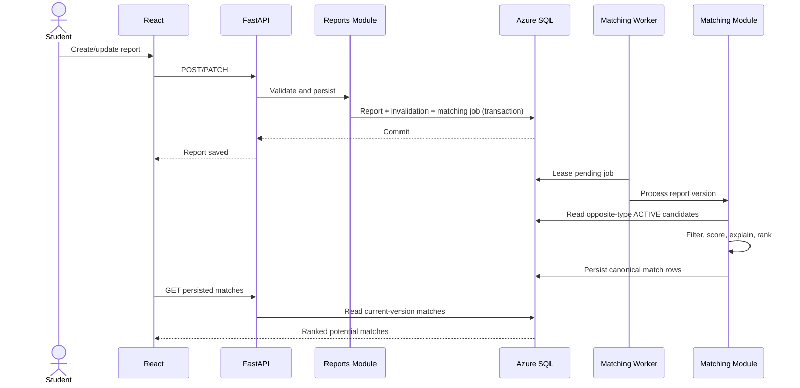

# Architecture — FindMyThing

**Status:** Frozen v1.0 — owner-directed design freeze  
**Purpose:** Define the system structure, responsibilities, interactions, deployment direction, security boundaries, and rationale.  
**Implementation status:** Not started  
**Owner approval:** Granted for documentation freeze; implementation remains separately gated

> This document records the frozen architecture derived from the research specification, complete agreed project scope, selected technology stack, and course/rubric alignment. It is not by itself authorization to begin implementation; implementation requires a separate explicit owner instruction.

---

## 1. Architectural goals

The architecture must:

1. Deliver the complete agreed F1–F6 project scope without scope expansion.
2. Be understandable and defensible in a university demo/viva.
3. Demonstrate System Design, DBMS/RDBMS, Azure/cloud, security, integration, and Design Thinking concepts naturally.
4. Keep implementation and deployment effort low enough for the project deadline.
5. Preserve report, claim, and recovery correctness.
6. Protect student accounts, claimant information, and item photographs.
7. Support a coherent Azure-native deployment using the owner's Azure for Students subscription, subject to portal verification.

### Non-goals

The architecture does not target large-scale public traffic, multi-region high availability, independently deployed services, event streaming, or a production enterprise platform.

No AI/ML, computer vision, vector search, messaging, notifications, mobile application, microservices, Kubernetes, Kafka, Redis, or payment infrastructure is part of the project.

---

## 2. Frozen project context

FindMyThing is a secure campus lost-and-found and item recovery platform.

- Students report lost or found belongings, browse reports, view potential matches, submit claims, and track relevant statuses.
- Moderators may create reports (e.g. campus custodial FOUND reports), but cannot submit claims; another moderator must verify/recover claims on moderator-owned reports. Moderators review reports/claims, record recovery, and access audit/analytics information.
- Matching is deterministic and explainable.
- A potential match is a lead for review—not proof of ownership.
- The backend is the authority for identity, permissions, and workflow transitions.

The six complete agreed project scope capabilities are:

| ID | Capability |
|---|---|
| F1 | Authentication and role-based access control |
| F2 | Lost/found reporting |
| F3 | Deterministic potential matching |
| F4 | Claim, moderator verification, and recovery |
| F5 | Activity/audit logging |
| F6 | Analytics dashboard |

See `MVP_SCOPE.md` for the complete agreed F1–F6 scope (historical filename; not a reduced MVP).

---

## 3. Architectural style

### Frozen decision: modular monolith

The backend will be one FastAPI application deployed as one unit, organized into modules with explicit responsibilities.

It is not a collection of independently deployed services.

**Why this fits:**

- The team and project are small.
- The project has modest expected traffic.
- Claim approval/recovery requires coordinated relational transactions.
- One deployment is easier to test, operate, secure, and explain.
- The modular structure still demonstrates separation of concerns and maintainability.
- Microservices would add network boundaries, deployment complexity, distributed failure handling, and operational overhead without serving the project.

### Separation of concerns

The architecture separates:

- presentation (React frontend);
- HTTP/API and request handling;
- authentication and authorization;
- application/domain workflows;
- persistence and relational integrity;
- object/file storage;
- analytics/reporting.

The separation is logical within the modular monolith. It does not imply extra Azure services or separate deployables.

---

## 4. Logical component architecture

```text
Student / Moderator
        |
        | HTTPS
        v
React + TypeScript + Vite
(Azure Static Web Apps)
        |
        | REST/JSON + authenticated session
        v
FastAPI Modular Monolith
(Azure App Service)
  |
  +-- Authentication / Session / RBAC
  +-- Reports
  +-- Matching
  +-- Claims / Recovery
  +-- Attachments / Blob access
  +-- Audit logging
  +-- Analytics read endpoints (if needed by UI)
  |
  +----------------------+----------------------+
  |                      |                      |
  v                      v                      v
Azure SQL Database   Azure Blob Storage   Power BI Desktop
(system of record)   (private photos)     (read-only analytics)
```

### 4.1 Frontend

**Technology:** React + TypeScript + Vite  
**Hosting:** Azure Static Web Apps

Responsibilities:

- render student and moderator workflows;
- collect and display data;
- provide navigation, forms, filters, and status feedback;
- perform basic client-side validation for usability;
- show UI affordances appropriate to the user's role;
- call backend REST endpoints;
- display potential matches as suggestions, not confirmed ownership.

The frontend is not a security boundary. Client-side role state, route guards, and hidden buttons are usability mechanisms only. Every protected operation must be authorized by the backend.

The frontend must not connect directly to Azure SQL or receive database credentials, storage account keys, or unrestricted Blob access.

### 4.2 Backend API and application

**Technology:** FastAPI + Python  
**Hosting:** Azure App Service

The backend is the application authority. It is responsible for:

- request validation and response shaping;
- authentication and session lifecycle;
- authorization and role checks;
- business rules and workflow transitions;
- deterministic matching;
- database reads/writes;
- private attachment access;
- audit event creation;
- coordinating multi-step operations;
- returning safe errors and not exposing internal secrets.

### 4.3 Backend module boundaries

Proposed logical modules:

| Module | Responsibility | Must not own |
|---|---|---|
| Auth/session | Registration, login/logout, current identity, session invalidation | Report/claim business workflows |
| Users/RBAC | User identity, role and permission checks | Trusting client-supplied roles |
| Reports | Create, browse, retrieve, edit/close reports subject to permissions | Direct Blob public access |
| Matching | Compare eligible LOST and FOUND reports; explain scores | Confirming ownership |
| Claims/recovery | Claim submission, review, approval/rejection, recovery transition | Frontend-controlled approval |
| Attachments | Validate upload metadata, coordinate Blob and SQL metadata, authorized retrieval | Public containers or arbitrary blob-key access |
| Audit | Record important security/business events | Logging passwords, tokens, or sensitive claim text |
| Analytics | Provide safe summary/read model for dashboard | Mutating operational records |

These are logical boundaries, not a mandate for one Python file per module. The Blueprint will define package layout and exact interfaces.

### 4.4 Application-layer structure proposal

The Blueprint may use a structure similar to:

```text
backend/
  app/
    api/             # HTTP routes and request/response schemas
    core/            # settings, security, session, shared dependencies
    modules/
      auth/
      reports/
      matching/
      claims/
      attachments/
      audit/
      analytics/
    persistence/     # SQLAlchemy setup, repositories, migrations integration
```

This is illustrative. Exact folder structure and dependency patterns are frozen in Blueprint §2.

---

## 5. System-of-record and data architecture

### 5.1 Azure SQL Database

Azure SQL is the system of record for structured application state, including:

- users and roles;
- server-side session records;
- reports and their statuses;
- category/location reference data;
- attachment metadata;
- match candidates and their explanations/status;
- claims and review decisions;
- report status history;
- activity/audit events.

SQL is responsible for relational integrity, constraints, and transactions. The backend accesses SQL using the selected database access stack; the frontend never accesses SQL directly.

### 5.2 Azure Blob Storage

Blob Storage holds item photographs as private objects.

SQL stores attachment metadata and the opaque object key, not the image bytes.

Design rules:

- no anonymous/public container access;
- clients do not choose arbitrary storage object keys;
- access is mediated by backend authorization;
- upload constraints and content validation are enforced server-side;
- storage credentials remain server-side;
- v1 serves image bytes through an authorized backend stream; do not issue SAS URLs;
- no SAS tokens or secrets in audit logs.

Upload/retrieval, limits, validation, and retention are frozen in Blueprint and Implementation Contracts: optional report photo (one, 5,000,000 bytes), up to three claim evidence photos (5,000,000 bytes each), JPEG/PNG/WebP, private Blob, backend authorization, mandatory metadata-stripping re-encode, 90-day post-terminal purge.

### 5.3 Data ownership

| Data | Owner |
|---|---|
| Account, report, claim, status, and workflow state | Azure SQL |
| Photo bytes | Azure Blob Storage |
| Photo metadata and Blob object key | Azure SQL |
| Analytics definitions | SQL view/read model and Power BI report |
| Session state | SQL-backed server-side sessions (frozen; exact token/session fields in Implementation Contracts) |

The backend coordinates SQL and Blob operations. SQL and Blob do not share a distributed transaction. Upload to private Blob with random key, then persist metadata; if metadata persistence fails, attempt Blob deletion and record cleanup-needed if compensation fails. Photo is optional, so report creation can succeed without it.

---

## 6. Identity, authentication, authorization, and trust boundaries

### 6.1 Authentication direction

Selected project direction:

- passwords hashed with Argon2id;
- server-side sessions;
- opaque session identifier stored in a secure cookie;
- session state managed server-side;
- logout revokes/invalidates the session.

Cookie, session, CSRF, CORS, origin, token generation/storage, expiry, and rotation behavior are frozen in `IMPLEMENTATION_CONTRACTS.md`. Do not select or vary these controls independently.

### 6.2 Authorization

Backend authorization is mandatory on every protected operation.

**Student capabilities (conceptual):**

- access their own account;
- create and browse permitted reports;
- edit/close only reports allowed by policy;
- submit claims for eligible found reports;
- view their own claims and permitted status information.

**Moderator capabilities (conceptual):**

- access moderation queues;
- review claim information needed for verification;
- approve/reject claims;
- record recovery;
- review relevant audit information;
- access moderator analytics.

The frozen permission matrix and ownership exceptions are specified in the Blueprint.

The backend must not trust client-supplied:

- role or privilege;
- claimant/reviewer identity;
- report ownership;
- approval outcome;
- recovered status;
- arbitrary Blob keys.

### 6.3 Trust boundaries

```text
[Untrusted browser/client]
        |
        | HTTPS, validated request, session cookie
        v
[Backend trust boundary]
  authentication + authorization + validation
        |
        +---- controlled SQL access ----> [Azure SQL]
        |
        +---- controlled Blob access ---> [Private Blob]
        |
        +---- safe analytics output ----> [Power BI / dashboard]
```

Treat all browser input as untrusted, including form fields, query parameters, uploaded files, and client-side role state.

### 6.4 Cross-origin deployment concern

Azure Static Web Apps and Azure App Service use separate origins under custom hostnames on the same registrable domain. This same-site topology is mandatory; do not deploy unrelated default Azure hostnames for cookie authentication.

**Frozen origin topology:** Production frontend and API must use custom hostnames under the same registrable domain so browser requests are same-site while remaining separate origins. The API uses a host-only Secure/HttpOnly/SameSite=Lax cookie, credentialed fetch, exact CORS allowlist, per-session CSRF token, and strict Origin validation. This is already a frozen design decision; implementation must not re-select or alter it. Verify domain availability/cost during deployment. If unavailable, pause deployment and request an explicit owner decision. Do not deploy with wildcard CORS or cross-site cookies by improvisation.

---

## 7. Core workflow interactions

### 7.1 Registration and login

1. Browser submits credentials over HTTPS.
2. Backend validates input and normalizes account identifiers.
3. Registration hashes the password and creates the account with the permitted default role.
4. Login verifies the password hash.
5. Backend creates a server-side session and sets the session cookie.
6. Authenticated requests resolve identity from the session.
7. Logout invalidates the server-side session and expires the cookie.

The backend must prevent self-assignment of moderator privileges.

### 7.2 Report creation

1. Student submits report fields; the report is created without a photo in SQL.
2. Backend validates fields and authorization, records the report/audit event, and returns the report.
3. If desired, the frontend sends a separate photo upload request for the newly created report.
4. Backend validates and uploads the photo to private Blob Storage, then stores attachment metadata in SQL.
5. If metadata persistence fails after Blob upload, attempt Blob deletion and queue/record cleanup if compensation fails.
6. A photo failure does not roll back report creation; frontend displays a retryable attachment error.

The exact upload/replacement/delete/retrieval contract is defined in `IMPLEMENTATION_CONTRACTS.md`.

### 7.3 Deterministic matching

#### Architectural responsibility

Matching is a backend application/domain capability inside the FastAPI modular monolith. It is not a separate service or AI model.

- **Reports module** owns report creation, editing, and lifecycle state.
- **Matching module** owns eligibility checks, candidate comparison, scoring, ranking, explanation generation, and match-record lifecycle.
- **Persistence layer** reads/writes match and report data in Azure SQL.
- **API layer** authenticates requests, enforces authorization, and shapes responses.
- **Frontend** displays stored potential matches; it does not calculate authoritative scores or decide ownership.

#### Trigger and persistence model

The system follows the research specification: **matching is triggered after a report is created or materially updated, and matching results are persisted in Azure SQL.** This is not an on-demand-only design.

The report write, invalidation of existing affected matches, and matching work-item insertion commit together. After commit, the API attempts immediate matching for prompt results. A SQL-backed outbox worker processes pending jobs at startup and during API traffic. The operational worker/maintenance contract, lease duration, retry, and dead-job CLI are frozen in `IMPLEMENTATION_CONTRACTS.md`; do not add a broker or another service. This prevents a slow or failed calculation from rolling back a valid report and prevents the matching request from being lost on process restart.

The worker identifies the report and matching version, queries eligible opposite-type reports, calculates deterministic scores/explanations, upserts canonical persisted pair records, records report-version provenance, and leaves report lifecycle/ownership untouched. Job processing is idempotent and stale jobs are superseded. Retry details are frozen in Blueprint.

#### Matching eligibility and scoring

Matching compares a LOST report with a FOUND report in either direction. Same-type reports are never candidates.

Candidate generation applies hard filters before scoring:
- opposite report type;
- source report is not candidate;
- both reports are in match-eligible lifecycle states;
- candidate is in the permitted campus/location scope;
- no report is RESOLVED, WITHDRAWN, CLOSED, or otherwise ineligible;
- candidate visibility is permitted by authorization and privacy rules.

The research report's proposed weights are retained:

| Factor | Weight |
|---|---:|
| Category compatibility | 40% |
| Location compatibility | 25% |
| Date compatibility | 25% |
| Keyword similarity | 10% |
| **Total** | **100%** |

Conceptual formula:

`score = category × 0.40 + location × 0.25 + date × 0.25 + keywords × 0.10`

Each factor is normalized to 0–100. Blueprint §6 freezes exact category scoring, location zone scoring, 30-day linear date decay, deterministic Jaccard token overlap, threshold 50, and tie-break order. The research weights are retained.

The match record stores the numeric score and a deterministic factor breakdown/explanation. A score is a similarity ranking—not an ownership probability, claim validation, or recovery decision.

#### Component interaction



**Communication pattern:** internal module/service calls within the FastAPI worker. No HTTP between backend modules and no external broker/service.

#### Data and consistency boundaries

- Azure SQL is the source of truth for reports, statuses, and persisted match records.
- Match records are derived data and must carry enough provenance to be invalidated/recomputed when source or candidate reports materially change.
- Updating report A invalidates every canonical pair involving A and enqueues matching for A. Pair orientation is canonical LOST/FOUND, so no separate directional duplicate exists.
- Report status changes to RESOLVED/WITHDRAWN/CLOSED must invalidate related potential matches.
- Matching must not modify claims, approve ownership, or change report recovery state.
- The frontend displays only safe fields; sensitive claim evidence is not exposed through match responses.

#### Failure and operational behavior

- Report persistence and matching work enqueue are committed together in SQL; report save succeeds even if the matching worker later fails.
- A SQL-backed matching outbox/work queue provides durability. FastAPI worker leases jobs, retries with capped exponential backoff up to eight attempts, and marks exhausted jobs DEAD for repair. No external broker is used.
- Worker restarts resume pending jobs; version checks supersede stale jobs; processing is idempotent.
- Match rows carry report-version provenance and are invalidated immediately when relevant report state/content changes.
- Explicit recalculation is an audited repair operation, not the normal matching path.

Matching remains a suggestion mechanism. Claim submission and moderator review are separate workflows and must never be automatically triggered by a score.

### 7.4 Claim submission and review

- Claims always target an ACTIVE FOUND report; optional LOST report must be ACTIVE and owned by claimant.
- Claim lifecycle: PENDING → VERIFIED → RECOVERED, with REJECTED/CANCELLED terminal outcomes and exceptional audited recovery void.
- Multiple PENDING claims may coexist; at most one VERIFIED claim per FOUND and linked LOST report.
- Claim verification is moderator-only and does not change report status. A VERIFIED claim blocks new claims against that FOUND report.
- Report withdrawal/closure and owner edits are blocked while PENDING/VERIFIED claims reference that report.
- Sensitive claim statements/evidence are visible only to claimant and authorized moderators; report owner/finder does not see claim evidence or claimant identity before recovery.

### 7.5 Recovery transaction

Recovery is a moderator-confirmed physical handover, separate from claim verification. In one Azure SQL transaction:

1. Lock claim, affected reports, and conflicting claims in deterministic ID order.
2. Verify claim VERIFIED, reports ACTIVE, moderator permission/no conflict, and no other VERIFIED/RECOVERED claim conflict.
3. Insert recovery record and capture report version/status provenance.
4. Mark claim RECOVERED.
5. Resolve FOUND report and optional linked LOST report.
6. Reject competing PENDING claims linked to the same FOUND or LOST report.
7. Write claim history and audit; report status history is generated by the database trigger.
8. Commit; any failure rolls back all SQL state.

A recovery void is exceptional and audited. It returns the claim to VERIFIED and reopens only reports whose status/version still matches the recorded recovery result. If the report changed later, require moderator reconciliation instead of blind reversal.

### 7.6 Analytics

- Operational records are written through the backend application.
- SQL provides a view/read model for analytics.
- Power BI Desktop consumes analytics data through a read-only SQL principal/view.
- Analytics access is read-only.
- Analytics must not expose sensitive claimant evidence or unnecessary personal information.
- Power BI is not an operational workflow engine.

KPIs and definitions are frozen in Blueprint §10.1: counts by type/status, claims/recoveries, category/location distributions, trends, recovery rate by report cohort, and recovery time.

---

## 8. Audit and observability

Audit logging is a complete agreed project scope feature.

The system records important security and business actions, such as:

- registration and login/logout outcomes;
- authorization failures;
- report creation/update/closure;
- attachment upload outcome;
- claim submission and review;
- recovery;
- important moderation actions.

Audit records should capture appropriate actor, action, target, timestamp, outcome, and safe contextual metadata.

Do **not** log:

- passwords or password hashes;
- session identifiers/secrets;
- access tokens or SAS tokens;
- full sensitive claim evidence;
- unnecessary personal information;
- raw uploaded image contents.

The Blueprint must specify event taxonomy, retention, and which failures are logged. Audit records must not be editable through ordinary student workflows.

---

## 9. Azure deployment architecture

### 9.1 Intended deployment

```text
Internet
  |
  v
Azure Static Web Apps
  React SPA
  |
  | HTTPS / REST
  v
Azure App Service
  FastAPI API
  |                    |
  |                    |
  v                    v
Azure SQL Database   Azure Blob Storage
  |
  | Read-only analytics access (intended)
  v
Power BI Desktop
```

### 9.2 Selected Azure services

| Component | Azure service | Rationale |
|---|---|---|
| Frontend | Azure Static Web Apps | Managed hosting for the React SPA |
| Backend | Azure App Service | Managed hosting for FastAPI without container orchestration |
| Relational data | Azure SQL Database | Relational integrity and DBMS features required by the project |
| Photos | Azure Blob Storage | Object storage suited to image files |
| Analytics | Power BI Desktop | Required analytics/reporting deliverable |

The selected service names do not guarantee that the desired plan, quota, region, or pricing is available in the student subscription.

### 9.3 Configuration and secrets

- Secrets and connection strings must not be committed.
- Backend configuration must be supplied through protected app settings/environment configuration or an approved secret-management mechanism.
- Never expose SQL credentials or Blob account keys to the browser.
- Use HTTPS.
- Restrict Azure SQL network access to the required backend access path and administrator access only as necessary.
- Remove temporary firewall allowances after testing.
- Keep deployment configuration separate from application source.

### 9.4 Cost and availability assumptions

- Azure for Students is the intended subscription.
- Verify subscription eligibility, resource availability, quota, region, and cost before provisioning.
- Do not assume App Service or Azure SQL is free at the chosen tier.
- Avoid high availability, private endpoints, gateways, WAF, Kubernetes, and other costly or unnecessary services unless a rubric requirement or owner-approved need justifies them.
- Plan to stop/delete resources after the demo where appropriate.
- The project is a single-region academic demonstration, not a high-availability production service.

---

## 10. Failure handling and consistency

The system must account for ordinary partial failures without introducing distributed infrastructure.

| Failure | Architectural response |
|---|---|
| SQL operation fails | Return safe error; do not claim the operation succeeded |
| Blob upload fails | Do not persist a successful attachment reference; clean up any partial state |
| SQL metadata insert fails after Blob upload | Attempt compensating Blob deletion; record/handle cleanup failure |
| Claim/recovery transaction fails | Roll back; retain prior valid state |
| Concurrent moderator actions | Recheck state under transaction; reject stale/conflicting operation |
| Session expires/revoked | Require authentication again |
| Analytics query fails | Dashboard may show unavailable data; operational workflow must remain unaffected |
| Azure service temporarily unavailable | Show safe failure; do not bypass security or integrity checks |

The project does not need a message broker or background-job system for these cases. The Blueprint should define the simplest reliable implementation.

---

## 11. Security architecture and threat considerations

Security is a design concern across all layers.

### Primary threats

- account takeover or credential abuse;
- student privilege escalation;
- unauthorized claim approval;
- SQL injection;
- cross-site scripting;
- CSRF/session abuse;
- unauthorized disclosure of claimant information;
- malicious or oversized file upload;
- public or unauthorized Blob access;
- secrets committed to Git or exposed in frontend;
- database exposure through overly broad firewall rules;
- concurrent claim/recovery state corruption;
- resource exhaustion through abuse of endpoints or uploads.

### Architectural mitigations

- Argon2id password hashing;
- secure server-side sessions;
- backend-enforced RBAC and ownership checks;
- parameterized database access;
- strict input validation;
- safe React rendering; avoid unsafe HTML injection;
- CSRF defense appropriate to cookie/origin topology;
- narrow credentialed CORS policy;
- private Blob Storage and controlled retrieval;
- upload validation and size/type limits;
- secrets kept server-side and out of Git;
- Azure SQL firewall restrictions;
- safe error handling;
- audit logging without secrets;
- transactional recovery state changes.

Detailed security controls, test cases, upload limits, and threat-model evidence belong in the Blueprint and security checklist.

---

## 12. Course and rubric traceability

| Course/rubric area | Architecture evidence |
|---|---|
| System Design | Modular monolith, component boundaries, interactions, deployment diagram, trade-offs, failure handling |
| DBMS/RDBMS | SQL system of record, integrity, transaction boundary, data ownership, analytics view |
| Azure/cloud / AZ-900 | Azure service selection, managed services, deployment, configuration, cost/quota considerations |
| DP-900/data fundamentals | Structured SQL records, unstructured Blob photos, analytics/reporting |
| Cloud Security | Identity, RBAC, trust boundaries, HTTPS, secrets, firewall, private files, audit |
| Integration | React → FastAPI → SQL/Blob; SQL analytics → Power BI |
| Design Thinking | Student/moderator needs reflected in reporting, matching, claim, and recovery flows |
| AI-900 | Explain why deterministic matching is appropriate and why AI is deliberately excluded from project |

The project should demonstrate course knowledge through real design decisions. Do not add features simply to claim course coverage.

---

## 13. Trade-offs and rejected alternatives

### Modular monolith vs microservices

**Selected:** modular monolith.

Benefits: simpler deployment, lower operational overhead, easier transactions, easier debugging, easier viva explanation.

Costs: modules share one deployment and runtime; scaling is not independently granular.

The costs are acceptable for the project.

### Azure-native hosting vs Vercel

**Selected:** Azure Static Web Apps + Azure App Service.

Reason: the project has Azure/cloud learning objectives and an Azure for Students subscription. Azure-native hosting makes the deployment and cloud choices part of the demonstration.

This is not a claim that Vercel is technically inferior. It is a project alignment decision.

### Azure SQL vs PostgreSQL

**Selected:** Azure SQL Database.

Reason: selected in research and aligned with Azure/data fundamentals and the current project rubric. Reconsider only if subscription/availability or course requirements make the selected option infeasible and the owner explicitly approves.

### Deterministic matching vs AI matching

**Selected:** deterministic matching.

Reason: transparent, explainable, testable, lower risk, and sufficient for the project. Ownership is verified by a moderator, not inferred by a model.

### Blob Storage vs storing images in SQL

**Selected:** private Blob Storage.

Reason: photos are unstructured object data; SQL stores metadata and relational workflow state.

### Power BI Desktop vs mandatory Power BI Service

**Selected:** Power BI Desktop baseline.

Reason: the research does not assume a Service license or paid publishing capability. Power BI Service may be considered only if available and approved.

---

## 14. Frozen architecture decisions

The following items were previously review questions and are now resolved:

| ID | Frozen decision | Implementation consequence |
|---|---|---|
| A-01 | Azure Static Web Apps frontend + Azure App Service API use same-site custom hostnames under one registrable domain | Separate origins, same-site cookie behavior; deployment requires domain configuration | 
| A-02 | Host-only Secure/HttpOnly/SameSite=Lax API session cookie, credentials-enabled fetch, explicit CORS origin, CSRF session token and strict Origin validation | If same-site domain cannot be obtained, deployment waits for owner approval of alternative | 
| A-03 | Modular monolith with explicit modules and service/repository boundaries | No independently deployed backend services | 
| A-04 | Private Blob upload followed by SQL metadata; compensate with Blob deletion on SQL failure | Optional photo; cleanup-needed maintenance path if compensation fails | 
| A-05 | Persisted deterministic matching, `match-v1`, SQL outbox/worker | Not on-demand-only; durable matching work and match rows | 
| A-06 | Report and claim states/transactions as defined in Blueprint | Recovery and competing-claim resolution are atomic | 
| A-07 | Power BI Desktop reads SQL analytics view/read model with read-only access | Operational writes remain in FastAPI | 
| A-08 | Azure region/tier/quota/cost checked in Azure Portal before provisioning | No assumed free tier or subscription entitlement | 
| A-09 | Moderator provisioning through interactive operator CLI | No public role self-elevation/default credentials | 
| A-10 | Audit retention 365 days; terminal photo/evidence retention 90 days | Maintenance purge with audit; SQL workflow records retained | 

## 15. Architecture freeze checklist

- [x] Modular monolith accepted.
- [x] Complete agreed F1–F6 scope retained without scope expansion.
- [x] SQL is the system of record for structured workflow state.
- [x] Private Blob Storage for photo bytes.
- [x] Backend authoritative for authentication, authorization, and state transitions.
- [x] Claim verification and physical recovery are separate.
- [x] Recovery and competing-claim changes are atomic in SQL.
- [x] Deterministic matching is persisted and does not establish ownership.
- [x] Matching trigger, SQL outbox, retry, invalidation, and versioning are frozen in Blueprint.
- [x] Power BI is read-only with respect to operational data.
- [x] Azure-native deployment direction is selected, subject to subscription verification.
- [x] Same-site session/CSRF/CORS topology is frozen.
- [x] Moderator provisioning, photo policy, audit retention, and analytics definitions are frozen.

**Architecture status:** Frozen v1.0. Changes require an owner-approved decision-register amendment. Implementation remains not started until the owner explicitly instructs it.
